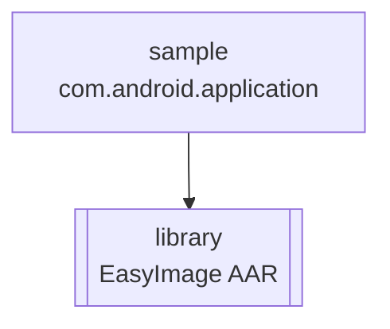

<div align="center">

# 📚 EasyImage

**Android library to pick images and videos from camera, gallery or documents · Glovo fork**

EasyImage is an Android library (AAR) that opens the camera, the gallery, the documents picker or a
system chooser, and hands the result back as files, without the usual `Intent` boilerplate. This repo is
Glovo's fork of [jkwiecien/EasyImage](https://github.com/jkwiecien/EasyImage) with a few fixes of its own.
It is **not** a service: nothing here is deployed, and the repo has no tests and no CI.

[](build.gradle)
[](build.gradle)
[](gradle/wrapper/gradle-wrapper.properties)
[](build.gradle)
[](build.gradle)
<br/>
[](build.gradle)
[](library/build.gradle)
[](https://github.com/jkwiecien/EasyImage)

</div>

---

## Table of contents

- [Overview](#overview)
- [Modules](#modules)
- [Adding a picker to your app](#adding-a-picker-to-your-app)
- [Build & local development](#build--local-development)
- [Repository layout](#repository-layout)
- [Contributing & conventions](#contributing--conventions)
- [Ownership & support](#ownership--support)

---

## Overview

EasyImage lets an app capture or pick **images and videos** from the gallery, the camera or the
documents picker without writing lots of boilerplate. The app builds one `EasyImage` instance, calls an
`open…()` method from an `Activity` or `Fragment`, and forwards `onActivityResult` to
`easyImage.handleActivityResult(…)`. On success the library calls `onMediaFilesPicked(MediaFile[], MediaSource)`;
on failure `onImagePickerError`, and on cancel `onCanceled`.

Under the hood ([`EasyImage.kt`](library/src/main/java/pl/aprilapps/easyphotopicker/EasyImage.kt),
[`Files.kt`](library/src/main/java/pl/aprilapps/easyphotopicker/Files.kt)):
- Camera output goes to a temp file in the app's `cacheDir/EasyImage/`, shared with the camera app through
  the library's own `FileProvider` (authority `<applicationId>.easyphotopicker.fileprovider`, declared in
  [`AndroidManifest.xml`](library/src/main/AndroidManifest.xml)).
- Files picked from the gallery or documents are **copied** into the same `cacheDir/EasyImage/` folder.
- With `setCopyImagesToPublicGalleryFolder(true)`, camera files are also copied to the public
  `Pictures/<folderName>/` folder and media-scanned.

**What Glovo changed** on top of upstream `3.0.0` (the Kotlin rewrite):

| Commit | Date | Change |
|---|---|---|
| `7e3c9e5` | 2019-07-23 | `openChooser(fragment)` starts the chooser from the fragment, so the result reaches the fragment's `onActivityResult` |
| `130ac7b` (GX-2742, PR #1) | 2020-03-10 | A chooser result whose intent has no `data` / `clipData` is treated as a camera photo instead of a gallery pick |
| `a77ac12`, `de8c0f4`, `1c1c89d` | 2019-07-23 – 2020-03-10 | `version_name` bumps to `3.0.1`, `3.0.2` and `3.0.3` |

> [!NOTE]
> On 2026-10-29 this fork was **6 commits ahead** of and **37 commits behind** upstream `master`
> ([compare](https://github.com/Glovo/EasyImage/compare/jkwiecien:EasyImage:master...Glovo:EasyImage:master)).
> The last commit here is from 2020-03-10. Glovo's changes touch only [`build.gradle`](build.gradle) and
> [`EasyImage.kt`](library/src/main/java/pl/aprilapps/easyphotopicker/EasyImage.kt).

| Module | Role | Deployable |
|---|---|---|
| [`library`](library) | The EasyImage AAR | — |
| [`sample`](sample) | Demo app that uses every `open…()` method | — |

| | |
|---|---|
| **Language / build** | Kotlin 1.3.21 (library), Java (sample) · Gradle 4.10.2 wrapper · Android Gradle Plugin 3.3.2 |
| **Android SDK** | compileSdk 28 · targetSdk 28 · minSdk 15 · AndroidX (`android.useAndroidX`, Jetifier on) |
| **Artifact** | AAR published with `maven-publish` as `com.github.jkwiecien:EasyImageLegacy:3.0.3` |
| **Releases** | Git tags; `3.0.2` and `3.0.3` are Glovo tags |
| **Tests / CI** | None in the repo |
| **Owner** | None recorded (no CODEOWNERS, no `catalog-info.yaml`) |
| **Licence** | Apache 2.0, © 2015 Jacek Kwiecień (upstream) |

---

## Modules



| Module | Convention plugin / build type | Main class or artifact | Notes |
|---|---|---|---|
| [`library`](library/build.gradle) | `com.android.library`, `kotlin-android`, `kotlin-android-extensions`, `maven-publish` | `EasyImage` · AAR `EasyImageLegacy` | Package `pl.aprilapps.easyphotopicker`; depends on AndroidX AppCompat 1.0.2 and `kotlin-stdlib-jdk7` |
| [`sample`](sample/build.gradle) | `com.android.application` | `MainActivity` (`pl.aprilapps.easyphotopicker.sample`) | Uses Picasso 2.71828 for thumbnails and Nammu 1.2.1 for runtime permissions |

Both modules read their versions and SDK levels from the `ext` block in the root
[`build.gradle`](build.gradle) (`version_name`, `version_code`, `compile_sdk_version`, `target_sdk_version`,
`min_sdk_version`). Changing a value there changes both modules.

---

## Adding a picker to your app

1. **Declare the permissions** in your `AndroidManifest.xml`. The library itself declares none:

   ```xml
   <uses-permission android:name="android.permission.WRITE_EXTERNAL_STORAGE" />
   <uses-permission android:name="android.permission.CAMERA" />
   ```

2. **Request them at runtime** on API 23 (Marshmallow) and above, before calling
   `easyImage.openCameraForImage()` or `openCameraForVideo()`. The [sample app](sample/src/main/java/pl/aprilapps/easyphotopicker/sample/MainActivity.java)
   shows how. If your app declares `CAMERA`, check it **together with** `WRITE_EXTERNAL_STORAGE`
   (see the warning below).
3. **Add the dependency.** The upstream library is on [JitPack](https://jitpack.io/#jkwiecien/EasyImage).
   This fork's `library` module publishes `com.github.jkwiecien:EasyImageLegacy:3.0.3`; the repo doesn't
   record where Glovo apps pull it from.
4. **Build one instance:**

   ```java
   EasyImage easyImage = new EasyImage.Builder(context)

   // Chooser only
   // Will appear as a system chooser title, DEFAULT empty string
   //.setChooserTitle("Pick media")
   // Will tell chooser that it should show documents or gallery apps, DEFAULT CAMERA_AND_DOCUMENTS
   //.setChooserType(ChooserType.CAMERA_AND_DOCUMENTS)  you can use this or the one below
   //.setChooserType(ChooserType.CAMERA_AND_GALLERY)

   // Setting to true will cause taken pictures to show up in the device gallery, DEFAULT false
   .setCopyImagesToPublicGalleryFolder(false)
   // Sets the name for images stored if setCopyImagesToPublicGalleryFolder = true, DEFAULT the app label
   .setFolderName("EasyImage sample")

   // Allow multiple picking, DEFAULT false
   .allowMultiple(true)
   .build();
   ```

5. **Open a source.** Each method takes an `Activity`, an AndroidX `Fragment` or a framework `android.app.Fragment`:

   | Call | Opens |
   |---|---|
   | `easyImage.openCameraForImage(activity / fragment)` | The camera, to take a picture |
   | `easyImage.openCameraForVideo(activity / fragment)` | The camera, to capture a video |
   | `easyImage.openGallery(activity / fragment)` | The gallery, or the gallery picker if there is more than 1 gallery app |
   | `easyImage.openDocuments(activity / fragment)` | The documents picker (`image/*`) |
   | `easyImage.openChooser(activity / fragment)` | A system picker with the camera apps plus documents (`CAMERA_AND_DOCUMENTS`) or the gallery (`CAMERA_AND_GALLERY`) |

   `easyImage.canDeviceHandleGallery()` tells you whether any gallery app is installed.

6. **Forward the result** and handle the callbacks. Extend `DefaultCallback` so only
   `onMediaFilesPicked` is required:

   ```java
       protected void onActivityResult(int requestCode, int resultCode, Intent data) {
           super.onActivityResult(requestCode, resultCode, data);

           easyImage.handleActivityResult(requestCode, resultCode, data, this, new DefaultCallback() {
               @Override
               public void onMediaFilesPicked(MediaFile[] imageFiles, MediaSource source) {
                   onPhotosReturned(imageFiles);
               }

               @Override
               public void onImagePickerError(@NonNull Throwable error, @NonNull MediaSource source) {
                   //Some error handling
                   error.printStackTrace();
               }

               @Override
               public void onCanceled(@NonNull MediaSource source) {
                   //Not necessary to remove any files manually anymore
               }
           });
       }
   ```

> [!WARNING]
> **Camera permission.** From the Android docs: *"If your app targets M and above and declares as using the
> CAMERA permission which is not granted, then attempting to use this action will result in a
> SecurityException."* If your app uses `CAMERA`, check it along **with** `WRITE_EXTERNAL_STORAGE` before
> calling `openCameraForImage()`.

> [!WARNING]
> **Fragments.** Only `openChooser(fragment)` starts the intent from the fragment (Glovo change). The other
> `open…(fragment)` methods start it from the host activity, so their result arrives in the **Activity's**
> `onActivityResult`. `handleActivityResult` always needs an `Activity` as its 4th argument
> ([`EasyImage.kt`](library/src/main/java/pl/aprilapps/easyphotopicker/EasyImage.kt)).

- **Request codes 34961–34965** are reserved by the library; `handleActivityResult` ignores any other code.
  Don't use these numbers for your own requests ([`Constants.kt`](library/src/main/java/pl/aprilapps/easyphotopicker/Constants.kt)).
- **`MediaSource` can differ from the call.** A pick from the gallery or the chooser comes back as `GALLERY`
  when the result carries `clipData`, else as `DOCUMENTS`; a photo taken through the chooser comes back as
  `CAMERA_IMAGE`. On cancel you get the source of the call (`CHOOSER` for the chooser).
- **Some devices**, such as Samsungs with their own gallery app, need the write permission for the gallery and
  documents pickers too. Testing is advised (comment in the sample's `MainActivity`).

<details><summary><b>Supporting SDK 14</b></summary>

Support for SDK 14 ended on version 1.3.1 (this fork's `minSdk` is 15). If you have to support SDK 14, use
that version of the upstream library:

```groovy
dependencies {
    implementation 'com.github.jkwiecien:EasyImage:1.3.1'
}
```

</details>

<details><summary><b>Known issues (from upstream)</b></summary>

- The library was rewritten from scratch in Kotlin on 2019-03-29. The initial version 3.0.0 might be
  unstable; in case of problems, fall back to version 2.1.1.
- Version 3.0.0 is not backward compatible and needs some changes from those who used earlier versions.
  The changes are small; the usage steps above show the 3.x API.

</details>

---

## Build & local development

> [!NOTE]
> **Prerequisites:** the Android SDK with platform 28 (`compile_sdk_version = 28`). The Gradle wrapper
> downloads Gradle 4.10.2, and the build resolves dependencies from `google()`, `jcenter()` and
> `https://jitpack.io` ([`build.gradle`](build.gradle)). The repo pins no JDK version.

```bash
./gradlew :library:assembleRelease      # build the release AAR
./gradlew :library:publishToMavenLocal  # publish com.github.jkwiecien:EasyImageLegacy:<version_name> to ~/.m2
./gradlew :sample:installDebug          # install the sample app on a connected device or emulator
./gradlew clean                         # delete build outputs
```

### Run locally

Install the [`sample`](sample) app. It has one button per source (gallery, camera, video, documents,
chooser), asks for `WRITE_EXTERNAL_STORAGE` at start with Nammu (and closes if refused), and shows the
returned images in a list with Picasso.
It builds EasyImage with `CAMERA_AND_GALLERY`, `allowMultiple(true)` and the folder name `EasyImage sample`.

### Build logic

There are no convention plugins. All versions sit in the `ext` block of the root [`build.gradle`](build.gradle):

| Key | Value |
|---|---|
| `version_name` | `3.0.3` |
| `version_code` | `12` |
| `kotlin_version` | `1.3.21` |
| `compile_sdk_version` / `target_sdk_version` | `28` / `28` |
| `min_sdk_version` | `15` |

The publication in [`library/build.gradle`](library/build.gradle) uses group `com.github.jkwiecien`,
artifact `EasyImageLegacy`, version `version_name`, and the `bundleReleaseAar` output.

---

## Repository layout

```text
.
├── build.gradle                 # root: versions (ext), AGP + Kotlin plugins, repositories
├── settings.gradle              # includes :sample and :library
├── gradle.properties            # AndroidX + Jetifier switches
├── gradle/wrapper/              # Gradle 4.10.2 wrapper
├── library/                     # ⭐ the EasyImage AAR
│   ├── build.gradle             # Android library + maven-publish (EasyImageLegacy)
│   └── src/main/
│       ├── AndroidManifest.xml  # declares EasyImageFileProvider
│       ├── java/pl/aprilapps/easyphotopicker/  # EasyImage, Files, Intents, MediaFile, callbacks
│       └── res/xml/easyimage_filepaths.xml     # FileProvider paths
├── sample/                      # demo app (Java) that depends on :library
├── CHANGELOG.md                 # upstream changelog, one entry (1.4.0)
└── README.md
```

`build/` dirs, `.gradle/`, `.idea/` and `local.properties` are git-ignored ([`.gitignore`](.gitignore)).

---

## Contributing & conventions

1. **Release by tag.** Bump `version_name` in the root [`build.gradle`](build.gradle), merge, then tag the
   commit with the same version. Tag `3.0.2` sits on the bump commit `de8c0f4`, and `3.0.3` on the merge
   commit of PR #1 (`77b2529`).
2. **Test by hand with the sample app.** The repo has no automated tests and no CI.
3. **Library code is Kotlin**, the sample is Java; both live under the package `pl.aprilapps.easyphotopicker`.

`master` has no branch protection and there is no CODEOWNERS file, so GitHub doesn't enforce a review.

---

## Ownership & support

- **Team:** none recorded. The repo has no CODEOWNERS and no `catalog-info.yaml`.
- **Last Glovo change:** GX-2742, merged as PR #1 on 2020-03-10.
- **Upstream:** [jkwiecien/EasyImage](https://github.com/jkwiecien/EasyImage) ·
  [JitPack](https://jitpack.io/#jkwiecien/EasyImage) ·
  [Android Arsenal](https://android-arsenal.com/details/1/2725)
- **Licence:** Apache License 2.0.

<details><summary><b>Licence notice</b></summary>

    Copyright 2015 Jacek Kwiecień.

    Licensed under the Apache License, Version 2.0 (the "License");
    you may not use this file except in compliance with the License.
    You may obtain a copy of the License at

       http://www.apache.org/licenses/LICENSE-2.0

    Unless required by applicable law or agreed to in writing, software
    distributed under the License is distributed on an "AS IS" BASIS,
    WITHOUT WARRANTIES OR CONDITIONS OF ANY KIND, either express or implied.
    See the License for the specific language governing permissions and
    limitations under the License.

</details>
